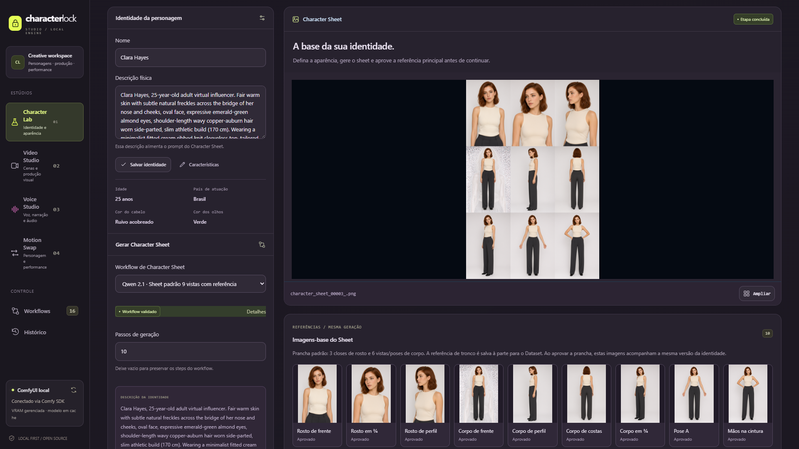
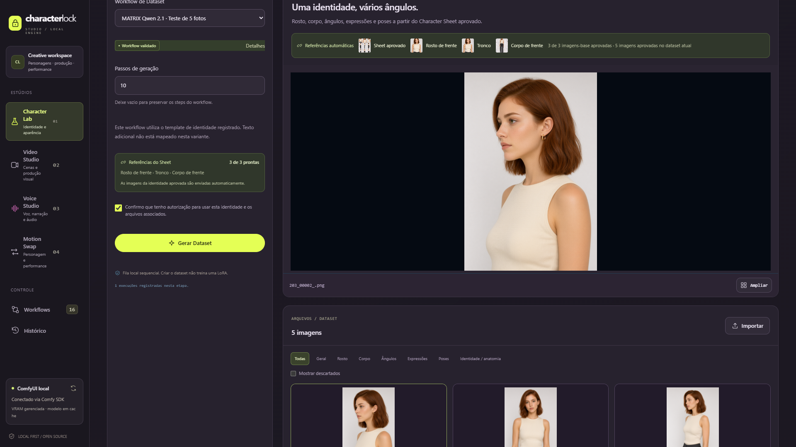
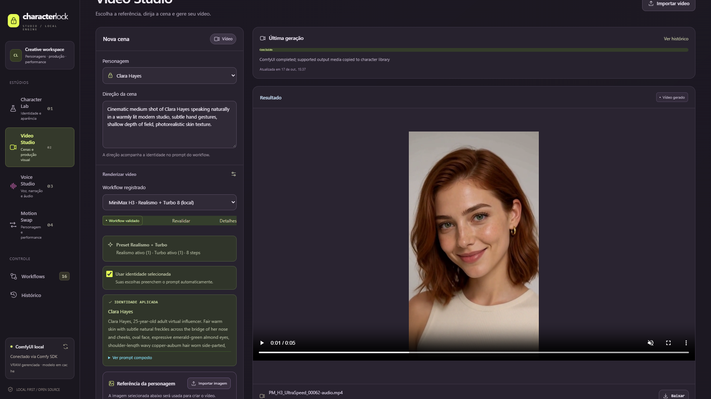
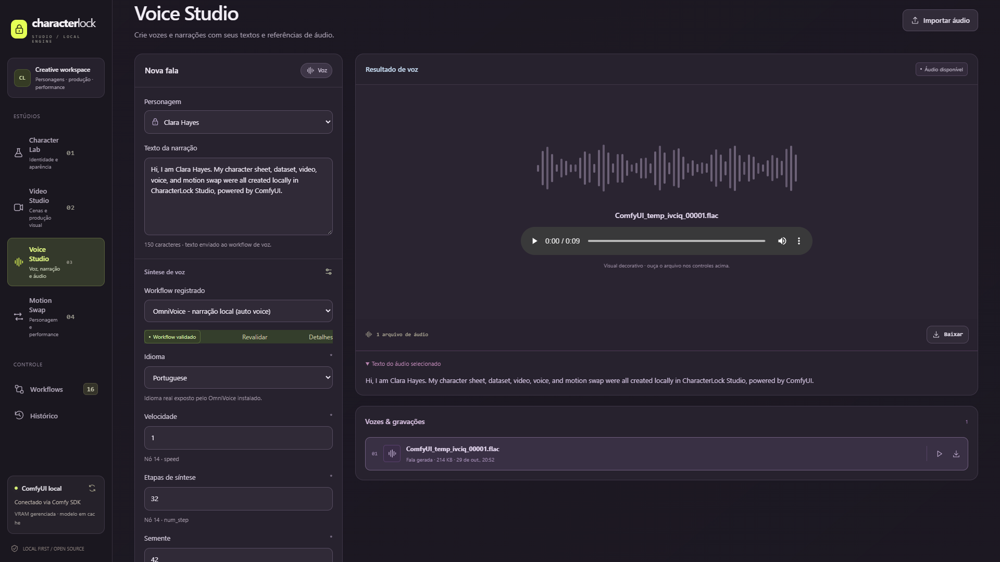
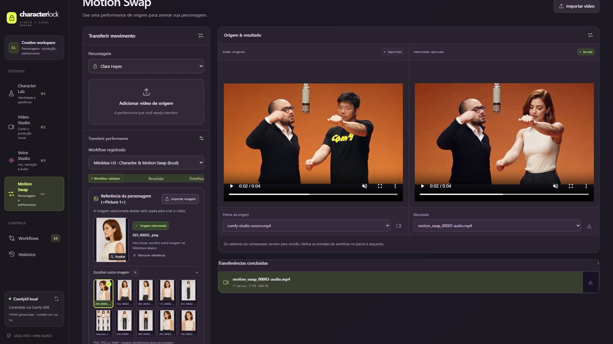
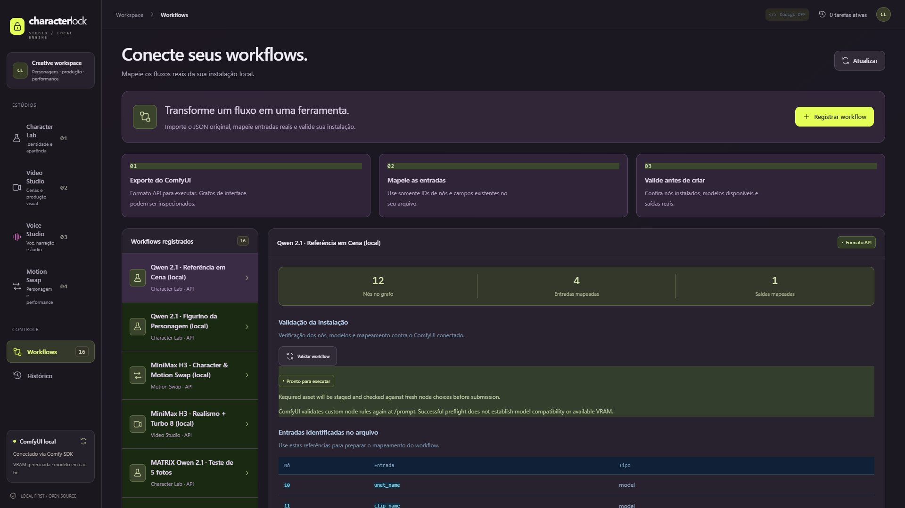
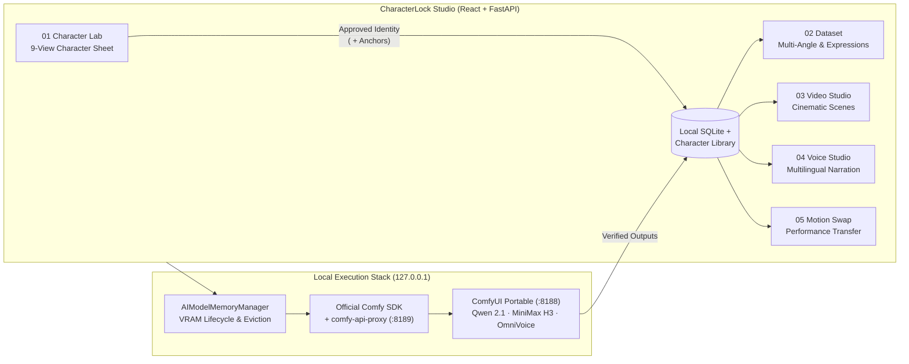

# CharacterLock Studio
*Create once. Keep the character. Produce everything.*

## Product presentation

### Presentation 1

https://github.com/user-attachments/assets/09911e70-1123-4bf9-b6bc-2c9f4d639c6d

### Presentation 2

https://github.com/user-attachments/assets/5e913a3d-4f2a-4b07-8bb8-327c34d93a25

---


**Open-source AI character production studio powered by ComfyUI and the official Comfy SDK.** Create consistent virtual characters once, build multi-angle datasets, generate cinematic reference-to-video scenes, synthesize multilingual voices, and transfer real human performances with Character Motion Swap — **100% locally on consumer 16 GB GPUs**.

[](LICENSE)
[](https://www.comfy.org/)
[](#download-for-windows)
[-f59e0b.svg)](README.pt-BR.md)

> **Quick Links:** [Download for Windows (`.exe` ZIP)](../../releases/latest) · [Demo Video (`<120s`)](examples/characterlock-studio-demo.mp4) · [Motion Swap Before & After](examples/motion-swap-before-after.mp4) · [Installation Guide](docs/INSTALLATION.md) · [Redistributable Workflows](workflows/presets/) · [Model Manifest](models-manifest.json)

---

## What is CharacterLock Studio?

Most local generative AI workflows force creators to rebuild node graphs, re-upload reference images, and manually juggle VRAM every time they move from character design to video, voice, or motion transfer.

**CharacterLock Studio** turns **ComfyUI** into a cohesive, studio-grade virtual character production suite with **persistent character identity**:

1. **Create & Lock Identity Once:** Generate a 9-view **Character Sheet** in **Character Lab** (or import a portrait) and approve the canonical identity revision.
2. **Automatic Cross-Studio Reuse:** Your character's approved face, upper-body, and full-body anchors flow automatically into **Dataset**, **Video Studio**, **Voice Studio**, and **Motion Swap** — zero manual node rewiring.
3. **100% Local & Memory-Managed:** Powered by the official **Comfy SDK** (`comfy-sdk` + `comfy-api-proxy`) and `AIModelMemoryManager`, which automatically unloads heavy diffusion/video/voice pipelines between studios so the entire suite runs reliably on a **16 GB VRAM GPU** (validated on an **NVIDIA GeForce RTX 5060 Ti 16 GB**).

*(Note: CharacterLock Studio is an independent open-source community project built for the [Open Source Higgsfield Challenge](https://comfy.org/open-source-higgsfield) and is not affiliated with or endorsed by Higgsfield AI.)*

---

## Demo

- **Full Studio Demo (`<120s`, 1080p MP4 with real OmniVoice & Motion Swap audio):** [`examples/characterlock-studio-demo.mp4`](examples/characterlock-studio-demo.mp4) *(also attached on [GitHub Releases](../../releases/latest))*
- **Synchronized Motion Swap Before & After (MP4):** [`examples/motion-swap-before-after.mp4`](examples/motion-swap-before-after.mp4)
- **Curated Real Outputs (Sheets, Dataset, Video, Voice, Motion Swap):** [`examples/`](examples/)


---

## Features

### 01 · Character Lab — Qwen Image 2.1 Identity & 9-View Character Sheet
Design original adult virtual characters via structured attributes or natural-language prompts, generate a 9-view turnaround **Character Sheet** (`Qwen Image 2.1`), inspect companion face/upper-body/full-body anchors, and lock an immutable identity revision. Also includes dedicated **Outfits** and **Scene References** stages.



### 02 · Dataset — MATRIX Qwen 2.1 Multi-Angle & Expression Gallery
Automatically binds your approved Character Sheet anchors (`Face`, `Upper Body`, `Full Body`) into **MATRIX Qwen 2.1** pipelines to generate consistent facial expressions, profile views, 360° head turns, torso angles, and full-body reference datasets.



### 03 · Video Studio — MiniMax H3 Reference-to-Video + Audio
Direct cinematic scenes using your character's locked identity (`<Picture 1>`) with **MiniMax H3 Singularity Ref2VA (INT8)**, **Realism People LoRA**, and **LightX2V 8-Step Turbo LoRA**, producing MP4 clips with synchronized ambient/speech audio.



### 04 · Voice Studio — Local Multilingual Speech with OmniVoice
Synthesize clear, expressive dialogue and voiceovers in English, Portuguese, Spanish, French, German, Japanese, Chinese, Korean, and more using **OmniVoice** (`k2-fsa/OmniVoice`), stored directly in each character's local asset library.



### 05 · Motion Swap — Character Performance Transfer
Replace a target speaker in a source driving video (`<Video 1>`) with your CharacterLock identity (`<Picture 1>`) using **MiniMax H3 Ref2VA + Character Swap LoRA (`h3_character_swap_pro4500_1000`)**. Preserves native framing, camera motion, lighting, scene background, other people in the shot, and body/hand gestures. Includes [`GERADOR_PROMPT_MOTION_SWAP.md`](GERADOR_PROMPT_MOTION_SWAP.md) for structured multi-person scene prompting.



### 06 · Local AI Engine — Comfy SDK + Automatic VRAM Management
Connects seamlessly to an existing **ComfyUI Portable** installation without duplicating processes, validates every API workflow against live `/object_info` schemas before submission, streams job events through the official **Comfy SDK**, and orchestrates VRAM eviction via `AIModelMemoryManager`.



---

## How it works



---

## Download for Windows

Want a standalone app experience without installing Node.js, React, or Python manually?

1. Go to **[GitHub Releases](../../releases/latest)** and download **`CharacterLockStudio-Windows-x64.zip`**.
2. Extract the archive to any folder (e.g., `C:\CharacterLockStudio`).
3. Ensure **ComfyUI Portable** (`ComfyUI_windows_portable`) is present at `%USERPROFILE%\ComfyUI_windows_portable` or `C:\ComfyUI_windows_portable` (or point `CHARACTERLOCK_COMFYUI_DIR` in `.env` to your existing ComfyUI folder).
4. *(First time only)* Run **`Setup-Models.bat`** to inspect your GPU/VRAM and download models modularly for the studios you want.
5. Double-click **`CharacterLockStudio.exe`** — the local server starts, connects to ComfyUI + Comfy SDK, seeds all 16 studio workflows into a clean library, and opens `http://127.0.0.1:8000` in your browser.

---

## Quick Start

### Option 1 — Windows Executable (`CharacterLockStudio.exe`)

```bat
REM 1. Check hardware, ComfyUI installation, custom nodes, and installed models:
CharacterLockStudio.exe --check-models

REM 2. Download models modularly (e.g., Character Lab + Voice Studio, or 'all'):
CharacterLockStudio.exe --setup-models --modules all --install-custom-nodes

REM 3. Start CharacterLock Studio:
CharacterLockStudio.exe
```

### Option 2 — Run from Source

**Prerequisites:** Windows 10/11 x64, Python 3.11+, Node.js 20+ (`pnpm` or `npm`), Git, and ComfyUI Portable.

```powershell
git clone https://github.com/natalinoalmeidajoaovitor-arch/CharacterLock-Studio.git
cd CharacterLock-Studio

# Install Python backend (.venv), Comfy SDK, and build the React frontend:
.\scripts\setup.ps1

# Verify GPU, ComfyUI custom nodes, and model manifest:
.\.venv\Scripts\python.exe scripts\model_setup.py --check-only

# Launch Studio on http://127.0.0.1:8000:
.\scripts\open-studio.ps1
```

See **[`docs/INSTALLATION.md`](docs/INSTALLATION.md)** for full setup details and manual fallback paths.

---

## Models and Dependencies

Model weights are **never committed to Git**. Instead, [`models-manifest.json`](models-manifest.json) and **CharacterLock Model Setup** (`scripts/model_setup.py` / `Setup-Models.bat`) provide modular, resumable downloads (via `aria2c` or built-in HTTP `Range`) with **exact byte-size and SHA-256 verification** directly from official Hugging Face repositories — **never downloading anything without explicit user confirmation**:

| Studio Module | Models Installed (Shared Weights Deduplicated Automatically) | Approx. Size |
| :--- | :--- | :--- |
| **Character Lab & Dataset** | `qwen_image_2.1_int8_convrot`, `qwen3vl_8b_w4a8`, `qwen_image_2.1_vae_bf16` | ~13.3 GB |
| **Voice Studio** | `k2-fsa/OmniVoice` (`model.safetensors`, `audio_tokenizer`, configs) | ~3.1 GB |
| **Video Studio** | `Minimax-h3_Singularity_ref2va_Pruned_v1.3_int8`, `qwen3vl_32b_minimax_h3-Q2_K_M.gguf`, `minimax_h3_video_vae_int8_convrot`, `minimax_h3_audio_vae_fp32`, `Realism People LoRA`, `LightX2V Turbo 8-Step LoRA` | ~35.4 GB |
| **Motion Swap** | Shares MiniMax H3 core + `minimax_h3_video_vae_fp16` + `h3_character_swap_pro4500_1000` LoRA | +5.0 GB |

**Required ComfyUI Custom Nodes** (detected and optionally cloned via `--install-custom-nodes`):
`MATRIX-LAB-Nodes`, `ComfyUI-Fantastic-MiniMaxH3-PromptBuilder`, `ComfyUI-GGUF`, `ComfyUI-KJNodes`, `ComfyUI-VideoHelperSuite`, `rgthree-comfy`, and `ComfyUI-Omnivoice`.

---

## Requirements

Specifications below reflect **actual tested hardware**, without invented minimums:

| Component | Tested Reference Configuration | Recommended Configuration |
| :--- | :--- | :--- |
| **OS** | Windows 10 / 11 x64 | Windows 11 x64 |
| **GPU** | **NVIDIA GeForce RTX 5060 Ti (16 GB VRAM)** | NVIDIA RTX GPU with 16 GB+ VRAM |
| **System RAM** | 16 GB RAM *(tested with automatic VRAM/RAM eviction)* | 32 GB+ RAM |
| **Storage** | ~65 GB free SSD space (for full 5-module model suite) | NVMe SSD with 100 GB+ free space |
| **CUDA / PyTorch** | ComfyUI Portable (`Python 3.13`, `PyTorch 2.14+cu130`) | ComfyUI Portable (`CUDA 12.4+ / 13.0`) |

---

## Open Source Architecture

- **Frontend (`frontend/`):** React 19 + TypeScript + Vite single-page workspace with dedicated studio views (`CharacterLab.tsx`, `StudioViews.tsx`, `GenerationPanel.tsx`, `WorkspaceTools.tsx`) and live WebSocket job telemetry.
- **Backend (`backend/app/`):** FastAPI local-loopback server (`LocalBoundaryMiddleware` DNS-rebinding & Origin protection), durable SQLite WAL repository (`db.py`), strict content-sniffed asset storage (`storage.py`), and immutable character revision tracking (`character_lab.py`).
- **Comfy SDK Integration (`sdk_comfy.py`, `sdk_proxy.py`, `engine_manager.py`):** Supervises ComfyUI (`127.0.0.1:8188`) and the official `comfy-api-proxy` (`127.0.0.1:8189`), reuses existing healthy ComfyUI instances without killing user processes, and executes validated API graphs through `comfy-sdk`.
- **Memory Orchestration (`memory_manager.py`):** `AIModelMemoryManager` tracks loaded model families (`qwen_image`, `minimax_h3`, `omnivoice`) and triggers `/free` (`unload_models` + `free_memory`) across pipeline switches to prevent OOM crashes on 16 GB GPUs.
- **Workflow Contracts (`workflows.py`, `workflows/presets/`):** Explicit allowlisted parameter mappings and preflight `/object_info` validation — zero fragile UI-graph widget index guessing.

See [`docs/ARCHITECTURE.md`](docs/ARCHITECTURE.md) and [`docs/API.md`](docs/API.md) for deep technical documentation.

---

## Supported Workflows

All **16 redistributable API-format workflows** in [`workflows/presets/`](workflows/presets/) are automatically seeded on first launch:

- **Character Lab (`character_lab`):**
  - `qwen21-sheet-9view-description` — 9-View Standard Character Sheet from text identity
  - `qwen21-sheet-9view-reference` — 9-View Standard Character Sheet from reference portrait
  - `qwen21-sheet-description` & `qwen21-sheet-reference` — Compact Character Sheets
  - `qwen21-base-identity` — Base Identity Portrait (`Qwen Image 2.1`)
  - `qwen21-character-outfit` — Character Outfit Generator
  - `qwen21-scene-reference` — Character in Scene Reference Generator
- **Dataset (`character_lab` / `dataset` stage):**
  - `matrix-qwen21-dataset-quick5` — 5-Photo Multi-Angle & Expression Pack
  - `matrix-qwen21-dataset-head` — Facial Expressions & Close-Ups (8 images)
  - `matrix-qwen21-dataset-head360` — 360° Head Turnaround (8 images)
  - `matrix-qwen21-dataset-upper360` — 360° Upper-Body Turnaround (8 images)
  - `matrix-qwen21-dataset-full360` — 360° Full-Body Turnaround (8 images)
- **Video Studio (`video_studio`):**
  - `minimax-h3-video-realism-turbo8` — MiniMax H3 Ref2VA + Realism People + 8-Step Turbo
  - `minimax-h3-video-base` — MiniMax H3 Local Base Video
- **Voice Studio (`voice`):**
  - `omnivoice-local-narration` — OmniVoice Multilingual Auto-Voice Narration
- **Motion Swap (`motion_swap`):**
  - `minimax-h3-motion-swap-5s` — Validated 5-Second Character & Motion Swap (`MiniMax H3 Ref2VA` + `h3_character_swap_pro4500_1000` + `Realism` + `Turbo 8`)

---

## Known Limitations

- **5-Second Validated Motion Swap Window on 16 GB VRAM:** In `v1.0.0`, Motion Swap is validated for 5-second clips (`5 + 17n` MiniMax H3 temporal quantization at `0.5 MP`, 8 steps) to fit reliably within 16 GB VRAM without temporal drift or OOM. Multi-chunk 15-second Long Motion Swap is excluded from this stable release.
- **External ComfyUI Portable Runtime:** `CharacterLockStudio.exe` bundles the complete Studio frontend, FastAPI backend, and Comfy SDK proxy, and connects to an external `ComfyUI_windows_portable` installation for CUDA/PyTorch inference rather than duplicating a multi-gigabyte CUDA toolkit inside the launcher ZIP.
- **No Built-in LoRA Training or Lip-Sync:** Dataset generation prepares high-consistency multi-angle reference packs for immediate zero-shot reference conditioning (`Qwen 2.1` & `MiniMax H3`), not automatic LoRA weight training or viseme lip-sync.
- **Separate Model Licenses:** Model checkpoints and LoRAs downloaded via `CharacterLock Model Setup` are governed by their upstream authors' terms (see [`THIRD_PARTY_LICENSES.md`](THIRD_PARTY_LICENSES.md)).

---

## License

- **CharacterLock Studio Source Code:** Licensed under the **[MIT License](LICENSE)**.
- **Third-Party Software, Custom Nodes & Model Weights:** Documented separately in **[`THIRD_PARTY_LICENSES.md`](THIRD_PARTY_LICENSES.md)**. Model weights are not covered by the application's MIT license; consult upstream Hugging Face model cards before commercial use.

---

## Open Source Higgsfield Challenge

CharacterLock Studio was built for the official ComfyOrg competition:
**[Open Source Higgsfield Challenge](https://comfy.org/open-source-higgsfield)** — demonstrating how open-source models (`Qwen Image 2.1`, `MiniMax H3`, `OmniVoice`, `Character Swap LoRA`) orchestrated through **ComfyUI** and the **Comfy SDK** can deliver an integrated, local-first virtual character studio on everyday creator hardware.

---

## Credits

Built with gratitude on top of the open-source ComfyUI ecosystem:
- **[ComfyOrg / ComfyUI](https://github.com/comfyanonymous/ComfyUI)** & **Comfy SDK (`comfy-sdk` / `comfy-api-proxy`)**
- **Qwen Team** & **Comfy-Org** (`Qwen-Image-2.1`, `Qwen3-VL`)
- **MiniMax**, **WarmBloodAban** (`Minimax-h3_Singularity`), **Unsloth** (`MiniMax-H3-GGUF`), **fal** (`MiniMax-H3-Realism-People-LoRA`), **Kijai** (`LightX2V Turbo LoRA` & `ComfyUI-KJNodes`), and **akatz-ai** (`MiniMax-H3-Character-Swap-LoRA`)
- **k2-fsa** (`OmniVoice`) & **wildminder** (`ComfyUI-Omnivoice`)
- **JsonMatrixLab** (`MATRIX-LAB-Nodes`), **Adudeguyman** (`ComfyUI-Fantastic-MiniMaxH3-PromptBuilder`), **city96** (`ComfyUI-GGUF`), **Kosinkadink** (`ComfyUI-VideoHelperSuite`), and **rgthree** (`rgthree-comfy`)
