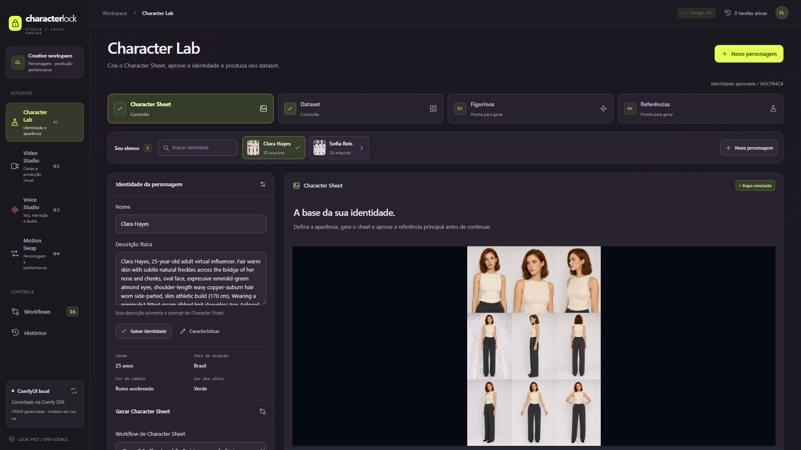
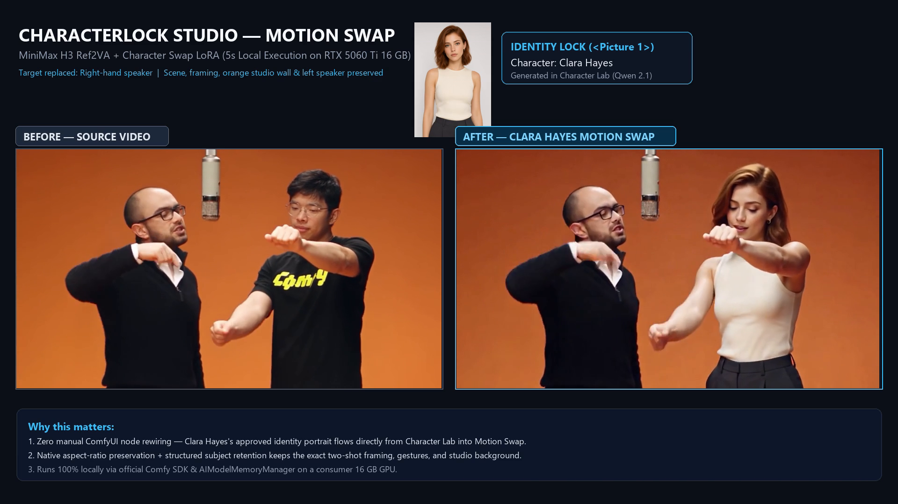

# CharacterLock Studio (Português — Brasil)
*Create once. Keep the character. Produce everything.*

> Read in English: **[README.md](README.md)**

O **CharacterLock Studio** é um estúdio open source de produção audiovisual para personagens virtuais com IA, construído sobre o **ComfyUI** e o **Comfy SDK oficial**, projetado para rodar **100% localmente no Windows** em GPUs de **16 GB de VRAM** (validado em **NVIDIA GeForce RTX 5060 Ti 16 GB**).

---

## Destaques

1. **Character Lab (Qwen Image 2.1):** Criação de personagens e geração de **Character Sheet de 9 vistas** com controle imutável de revisão de identidade.
2. **Dataset Persistente (MATRIX Qwen 2.1):** Reutilização automática das âncoras aprovadas (Rosto, Tronco e Corpo Inteiro) para gerar expressões e ângulos em 360°.
3. **Video Studio (MiniMax H3 Ref2VA):** Geração de vídeos com áudio sincronizado, LoRA de Realismo e LoRA Turbo de 8 steps.
4. **Voice Studio (OmniVoice):** Síntese de voz multilíngue local (Português, Inglês, Espanhol e mais) integrada à biblioteca da personagem.
5. **Motion Swap (MiniMax H3 + Character Swap LoRA):** Transferência de performance de 5 segundos preservando enquadramento, iluminação, cenário e demais pessoas em cena.
6. **Comfy SDK + `AIModelMemoryManager`:** Gerenciamento automático de ciclo de vida do ComfyUI e liberação inteligente de VRAM ao alternar entre estúdios.

---

## Como Executar no Windows (`CharacterLockStudio.exe`)

1. Baixe **`CharacterLockStudio-Windows-x64.zip`** em **[GitHub Releases](../../releases/latest)** e extraia em qualquer pasta.
2. Tenha uma instalação do **ComfyUI Portable** (`ComfyUI_windows_portable`) em `%USERPROFILE%\ComfyUI_windows_portable` ou `C:\ComfyUI_windows_portable` (ou defina `CHARACTERLOCK_COMFYUI_DIR` no arquivo `.env`).
3. Execute **`Setup-Models.bat`** na primeira vez para verificar sua GPU/VRAM e baixar de forma modular apenas os modelos necessários (`models-manifest.json` com retomada automática e verificação SHA-256).
4. Abra **`CharacterLockStudio.exe`** — a interface será iniciada automaticamente em `http://127.0.0.1:8000`.

Consulte **[`docs/INSTALLATION.md`](docs/INSTALLATION.md)** para instruções completas e **[`THIRD_PARTY_LICENSES.md`](THIRD_PARTY_LICENSES.md)** para licenças de software e modelos.
