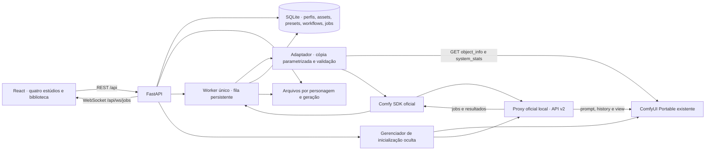

# CharacterLock Studio — arquitetura e primeira entrega

Aplicação local de produção com React + TypeScript + Vite + Tailwind, FastAPI,
SQLite e uma instância existente do ComfyUI. Esta entrega implementa a fundação;
qualidade de identidade, lip-sync e compatibilidade dos modelos dependem de
workflows reais e de validação na GPU. Não há geração simulada.

## 1. Limites e decisões

- O ComfyUI é um serviço local gerenciado. O backend detecta ou inicia a
  distribuição Portable existente em segundo plano, sem console ou navegador
  do motor. Não instala nem atualiza a distribuição, custom nodes ou modelos.
- Um processo FastAPI e um worker sequencial por máquina. SQLite é suficiente
  para o MVP local. Não iniciar o backend com vários workers.
- Os pesos permanecem na instalação atual. O Studio guarda metadados e assets;
  não mantém uma segunda cópia de dezenas de gigabytes de modelos.
- Apenas workflows exportados no **formato API** são executáveis. Gráficos da
  interface são inventariados e preservados, sem conversão heurística de widgets.
- Todo parâmetro público exige mapeamento explícito para um nó e input reais.
- Geração de dataset, treinamento de LoRA, voz e lip-sync são operações separadas.
- A primeira versão usa loopback. Acesso remoto requer outra fase com autenticação,
  autorização, limites de uso e transporte seguro.

## 2. Comunicação



O navegador comunica-se apenas com FastAPI. No desenvolvimento, Vite encaminha
`/api` e WebSocket para `127.0.0.1:8000`; a interface fica em
`127.0.0.1:5173`. O ComfyUI padrão fica em `127.0.0.1:8188` e o proxy do
SDK em `127.0.0.1:8189`. A API só declara a execução disponível quando ambos
estão conectados. O proxy não requer que o carregamento da GPU termine para iniciar.

Submissão, observação por ID e download passam pelo SDK oficial. Descoberta de
nós, status da máquina, fila nativa e staging de imagens permanecem nas rotas
nativas. O proxy mantém seu estado em `data/sdk-proxy/`, incluindo chaves de
idempotência e a chave que estabiliza identificadores das saídas entre reinícios.
Não há reenvio automático de submissão ambígua nem acesso a APIs pagas.

Rotas ComfyUI consultadas na documentação oficial: `/system_stats`, `/object_info`,
`/queue`, `/prompt`, `/history/{prompt_id}`, `/upload/image` e `/view`.
`/upload/image` é utilizado somente para imagens. Transporte de vídeo e áudio
exige um adaptador comprovado para os custom nodes instalados; não se inventa
um endpoint universal de mídia. O monitor da fundação consulta o histórico real
e publica estados reais ao navegador. Percentuais sem evidência não são exibidos.

Fontes: [rotas oficiais](https://docs.comfy.org/development/comfyui-server/comms_routes),
[exemplo oficial](https://github.com/Comfy-Org/ComfyUI/blob/master/script_examples/websockets_api_example.py),
[servidor de referência](https://github.com/Comfy-Org/ComfyUI/blob/master/server.py).

## 3. Organização do projeto

```text
CharacterLockStudio/
├── frontend/                    React, TypeScript, Vite e Tailwind
│   ├── src/                     interface, cliente REST e estado
│   ├── package.json
│   ├── pnpm-lock.yaml            dependências resolvidas
│   └── vite.config.ts           proxy local REST e WebSocket
├── backend/
│   ├── app/
│   │   ├── main.py              rotas e ciclo de vida FastAPI
│   │   ├── characters.py        catálogo de seleções e composição de identidade
│   │   ├── character_lab.py     etapas, aprovações, revisões e referências
│   │   ├── settings.py          configurações locais
│   │   ├── db.py                persistência SQLite
│   │   ├── storage.py           validação e acesso a arquivos
│   │   ├── jobs.py              fila, execução, resultados e recuperação
│   │   ├── workflows.py         inspeção, mapeamento e validação
│   │   ├── comfy.py             transporte real do ComfyUI
│   │   ├── sdk_comfy.py         execução e resultados pelo SDK oficial
│   │   ├── sdk_proxy.py         proxy local oculto e estado combinado
│   │   └── engine_manager.py    partida oculta, detecção e recuperação limitada
│   ├── tests/                   testes de contrato, segurança e recuperação
│   ├── requirements.txt
├── workflows/
│   ├── originals/              cópias privadas imutáveis, fora do Git
│   └── mappings/               mapeamentos de parâmetros
├── scripts/                    instalação, execução e backup
├── docs/
│   ├── ARCHITECTURE.md          este documento
│   ├── WORKFLOWS_REQUIRED.md    arquivos exatos e critérios de aceitação
│   ├── API.md                  contratos e exemplos
│   ├── openapi.json            contrato gerado do backend
│   ├── schema.sql              tabelas extraídas do código
│   └── VALIDATION.md           evidências e limitações desta entrega
├── data/                       criado em execução; fora do Git
│   ├── characterlock.sqlite3
│   ├── workflows/              versões registradas e mapeamentos
│   ├── jobs/<job_id>/           prompt parametrizado e histórico real
│   ├── tmp/                    uploads incompletos
│   └── characters/<id>/
│       ├── profile.json
│       ├── identity/
│       ├── character_sheets/
│       ├── dataset/
│       ├── outfits/
│       ├── references/
│       ├── expressions/
│       ├── poses/
│       ├── loras/
│       ├── audio/
│       └── videos/
├── backups/                    snapshots locais; fora do Git
├── .venv/                      Python isolado; fora do Git
├── .env.example
├── LICENSE                     MIT para o código próprio
└── README.md
```

Nomes finais de arquivos e tabelas são conferidos com o código implementado.
Os originais do usuário não são distribuídos com a licença MIT. Licenças de
modelos, LoRAs, custom nodes, vozes e mídia devem ser revisadas separadamente.

## 4. Esquema de dados

| Entidade | Campos e relações |
| --- | --- |
| Character | UUID, nome, descrição, prompt de identidade, atributos selecionados em JSON, confirmação de autorização e timestamps; preview derivado da imagem de identidade mais recente do próprio personagem |
| Asset | UUID, character_id, categoria, nome original, caminho interno gerado, MIME verificado, bytes, metadados e job_id de origem quando gerado |
| Preset | UUID, character_id, nome, parâmetros JSON e timestamp; não implica compatibilidade de modelo |
| Workflow | UUID, nome, módulo, JSON original, hash, mapeamento, relatório de inspeção e validação; registro versionado por UUID |
| Job | UUID, módulo, character_id, workflow_id, parâmetros, assets de entrada, estado, prompt_id ComfyUI, erro, outputs e timestamps |

O criador usa um catálogo de opções com IDs estáveis, consultado em
`GET /api/character-options`. Idade, país, aparência, cabelo, corpo, figurino
e estilo são seleções persistidas em `attributes`. O backend valida cada
valor e compõe descrição e prompt automaticamente. País não determina tom
de pele, características físicas, idioma ou comportamento. Perfis legados
ganham atributos vazios sem alteração dos prompts existentes.

SQLite é a fonte de verdade. `profile.json` é uma representação legível da
biblioteca, não um segundo banco que o navegador pode editar livremente.
Arquivos são servidos por ID de asset, nunca por um caminho enviado pelo cliente.
O backend confere que personagem, assets e preset pertençam à mesma biblioteca.

Estados previstos: `queued → preparing → submitting → running → succeeded/failed`.
Também existem `cancelled` para fila local e `needs_attention` quando o estado
externo é ambíguo. Reinício com `prompt_id` permite reconciliar histórico/fila;
um envio interrompido sem ID não é repetido automaticamente. Cancelamento global
do ComfyUI não é usado para cancelar jobs que possam pertencer a outro cliente.

## 5. Contratos dos quatro estúdios

Character Lab, Video Studio, Voice Studio e Motion Swap possuem interfaces
próprias e navegação independente. Compartilham `characters`, `assets`,
`presets`, `workflows` e `jobs`.
O campo `module` distingue `character_lab`, `video_studio`, `motion_swap` e
`voice` (Voice Studio independente). A API REST detalhada está em `API.md`
e o contrato executável em `openapi.json` e `/docs`.

| Ação | Contrato |
| --- | --- |
| Catálogo do criador | `GET /api/character-options` |
| Biblioteca | `GET/POST /api/characters`, `GET/PATCH /api/characters/{id}` |
| Referências | `GET/POST /api/characters/{id}/assets`, `GET /api/assets/{id}/file` |
| Presets | `GET/POST /api/characters/{id}/presets` |
| Workflows | `GET/POST /api/workflows`, `GET /api/workflows/{id}`, `POST /api/workflows/{id}/validate` |
| Geração nas abas | `POST /api/jobs`, com módulo, personagem, workflow, parâmetros e assets mapeados |
| Monitor | `GET /api/jobs`, `GET /api/jobs/{id}`, `WS /api/ws/jobs` |
| Cancelamento seguro | `POST /api/jobs/{id}/cancel`, somente enquanto ainda estiver na fila local |
| Diagnóstico | `GET /api/health`, `GET /api/system` |
| Motor local | `GET /api/engine/status`, `POST /api/engine/start` |

Nenhuma aba pressupõe IDs de nós, resoluções, duração, idioma ou nomes de vozes.
O formulário é derivado do mapeamento importado. Inputs e opções são conferidos
contra `/object_info` e novamente antes do envio. Referências e LoRAs não
mapeadas não são aplicadas silenciosamente.

## 6. Adaptadores modulares

`WorkflowAdapter` não é um gerador de workflows. Ele recebe o export API
original e um mapeamento de inputs públicos, inspeciona sua estrutura, valida
classes e opções instaladas e produz uma cópia parametrizada. Campos ligados
a outros nós não são substituídos por valores arbitrários.

Uma interface de transporte (`ComfyClient`) separa a API do motor. A extensão
para pipelines específicos acontece por adaptadores reais de entrada/saída:

- Character Lab: Character Sheet aprovado → Dataset → Figurinos → Referências.
  Expressões e poses são categorias do Dataset. Associações de workflows são
  explícitas; o retrato legado não é aprovado nem associado automaticamente.
  A descrição pertence à etapa Character Sheet; não há etapa separada de
  geração de identidade. As tabelas aditivas `lab_*` guardam revisões,
  aprovações e snapshots sem mover arquivos legados. Consulte
  [CHARACTER_LAB.md](CHARACTER_LAB.md).
- Video Studio: imagem/vídeo e identidade conforme o workflow; referências de
  áudio somente após validação do transporte e do nó receptor.
- Voice: geração e importação de áudio independentes; nenhuma integração direta
  entre OmniVoice e MiniMax é presumida.
- Motion Swap: vídeo-fonte, referências, LoRA de transferência, recorte e saída
  conforme um workflow comprovado. Sem parâmetros de recorte inventados.

Na validação e na execução, o servidor rejeita parâmetros desconhecidos, nós ausentes, mapeamentos inválidos,
opções de modelo não instaladas e arquivos de input incompatíveis. O registro
pode guardar um grafo inválido para inspeção, sem habilitar sua execução. Um workflow
importado ainda pode executar código de custom nodes do ComfyUI: importar apenas
workflows confiáveis é parte do modelo local, não uma sandbox de nós arbitrários.

## 7. Modelos existentes e orçamento de memória

O inventário inicial encontrou uma instalação Portable e arquivos com nomes de
Qwen Image 2.1, MiniMax H3, OmniVoice e LoRA de character swap. Existência do
arquivo não prova carregamento, versão, licença ou compatibilidade do pipeline.
O endpoint estava indisponível durante a inspeção inicial.

Reaproveitar os caminhos e o `extra_model_paths.yaml` já existentes. Não editar
esse YAML nem mover pesos durante a fundação. A lista de opções de `/object_info`
é a autoridade para os loaders da instância em execução.

Executar um job por vez. Começar com resoluções e duração já comprovadas nos
workflows existentes; registrar tempo, VRAM/RAM máxima, frames e erros reais.
Descarregamento por `/free` requer que a instância esteja ociosa e sob controle
do Studio; não ativá-lo automaticamente em uma instância compartilhada. Flags
de low-VRAM e offload só serão ajustadas com evidência do pipeline e explicação
da mudança. A fila local não impede outro cliente de usar o mesmo ComfyUI.

## 8. Plano incremental do MVP e critérios de aceite

1. **Fundação (esta entrega):** interface e backend executáveis; biblioteca,
   uploads, presets, registro/validação de workflows, fila persistente, monitor,
   tratamento de falhas e documentação. Testes sem consumo de GPU; conexão
   indisponível reportada de forma explícita.
2. **Character Lab:** importar export API Qwen real; validar nós/modelos; gerar
   uma imagem de teste na GPU com parâmetros e outputs persistidos. Só depois
   adicionar sheets e organização/exportação de dataset. Nenhum treinamento.
3. **Video Studio:** importar export MiniMax real; validar referência de imagem
   e saída MP4; medir memória com vídeo curto; manter assets por personagem.
4. **Áudio:** validar export OmniVoice, opções de voz e salvamento; depois testar
   separadamente lip-sync e integração com o workflow de vídeo escolhido.
5. **Motion Swap:** validar LoRA e transporte de vídeo; teste com referência
   autorizada; comparar frames e registrar falhas faciais, corporais, temporais,
   composição e áudio. A comparação humana é evidência, não garantia de perfeição.
6. **Entrega pública:** testes reais dos pipelines, revisão de licenças e
   dependências, limpeza de mídia/dados privados, repositório público, demo e
   regras atuais da competição. Publicação e submissão ficam para essa fase.

O próximo passo de integração é obter **exports API dos workflows disponíveis**
e validar `/object_info` após a conexão automática. A lista precisa de
arquivos está em `WORKFLOWS_REQUIRED.md`.
